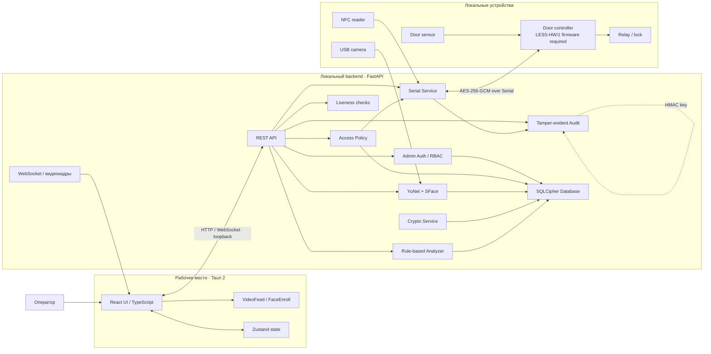
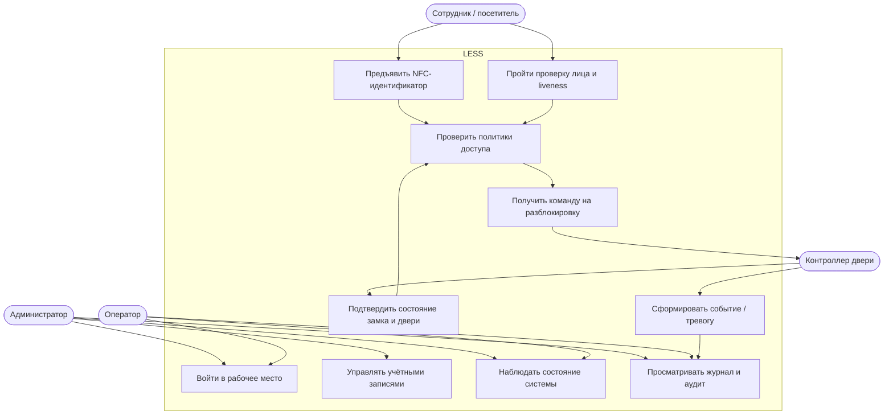
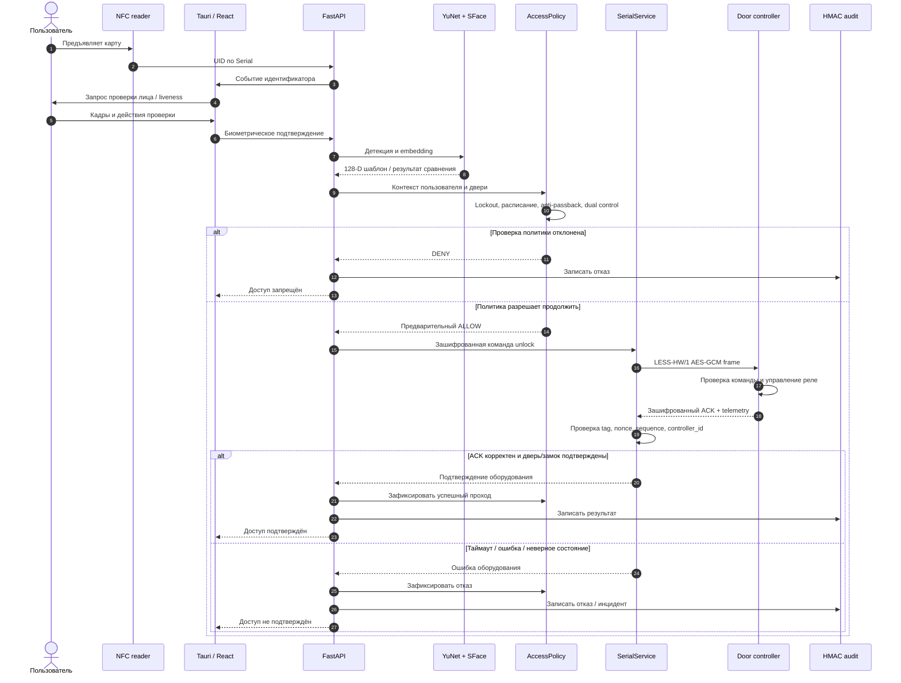
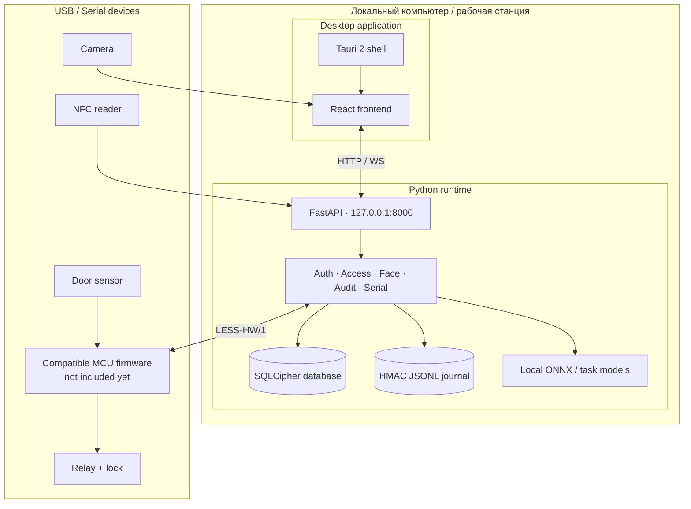

# LESS — Local Entry Security System

<p align="center">
  <strong>Локальная система контроля и управления доступом</strong><br/>
  Многофакторная проверка · защищённое хранилище · рабочее место оператора
</p>

<p align="center">
  <a href="https://github.com/VinfinityVois/LESS">GitHub</a>
  ·
  <a href="docs/ARCHITECTURE.md">Архитектура</a>
  ·
  <a href="docs/SETUP_VSCODE.md">Установка</a>
  ·
  <a href="backend/CONTROLLER_PROTOCOL.md">Протокол контроллера</a>
</p>

---

## О проекте

**LESS (Local Entry Security System)** — локально развёртываемый программно-аппаратный прототип СКУД. Система объединяет рабочее место оператора, серверную логику принятия решений, локальную обработку видеокадров, учёт идентификаторов доступа и защищённое взаимодействие с контроллером двери.

Основная задача проекта — не просто проверить предъявленный идентификатор, а выполнить последовательность проверок, применить политики доступа, зафиксировать результат и передать команду замку только при выполнении необходимых условий.

> **Текущий статус разработки.** README описывает рабочую ветку `feat/biometric-ai-analytics`, созданную от `feat/admin-users-biometric-workflow`; изменения этой ветки ещё не слиты в `main`. Backend-часть защищённого протокола контроллера реализована, но совместимая прошивка микроконтроллера и физический стенд ещё требуют разработки и испытаний. Не используйте проект как готовую промышленную СКУД без отдельной валидации и сертификации.

## Возможности

### Проверка доступа
- Считывание NFC UID через последовательный порт.
- Локальная детекция лица и построение биометрического шаблона YuNet + SFace.
- Проверка соответствия лица предъявленному идентификатору в поддерживаемом сценарии прохода.
- Активная liveness-проверка на стороне клиентского приложения; она является эвристической проверкой, а не сертифицированным средством защиты от подмены изображения или deepfake.
- Политики доступа: расписание, anti-passback, двойной контроль и гостевые коды с ограничением срока/числа использований.
- Фиксация успешных и отклонённых попыток.

### Безопасность данных и управления
- Шифрование файла базы данных SQLite средствами SQLCipher 4.
- Дополнительное шифрование биометрических материалов AES-GCM.
- Хеширование паролей администраторов Argon2id; серверные сессионные токены хранятся в виде хешей.
- Ролевое разграничение административных полномочий: `superadmin`, `admin`, `security`.
- Ограничение частоты неудачных попыток входа в административную панель.
- Отдельный JSONL-журнал с цепочкой HMAC-SHA256 для обнаружения изменения, удаления или перестановки записей.
- Протокол `LESS-HW/1` для конфиденциального и аутентифицированного обмена backend с контроллером двери на базе AES-256-GCM.
- Fail-closed: отсутствие ключа, корректного подтверждения контроллера или достоверного состояния двери не должно приводить к разрешению прохода.

### Рабочее место оператора
- Панель текущего состояния системы и оборудования.
- Страница прохода с видеопотоком и этапами проверки.
- Управление пользователями и административными учётными записями.
- Непрерывное распознавание зарегистрированного лица в мониторинге независимо от предъявления карты/PIN/отпечатка; распознавание само по себе не разрешает проход.
- Истёкшие и исчерпанные гостевые пропуска автоматически архивируются; в интерфейсе отображается живой обратный отсчёт до даты окончания.
- API защищён ограниченным per-IP token bucket и лимитом Content-Length для запросов.
- План тестирования, 200 синтетических сценариев и безопасный локальный load harness: `docs/SECURITY_TEST_STRATEGY.md` и `backend/tests/fixtures/security_test_dataset.csv`.
- Регистрация сохраняет зашифрованную 478-точечную геометрию лица и грубую оценку пропорций; очки/маска отмечаются оператором, а не автоматически. Боковые точки лица не являются отдельным распознаванием ушей.
- Журнал с ежедневным архивом по локальной дате, сводкой первых/повторных попыток и CSV-экспортом.
- Просмотр журнала событий и состояния защищённого аудита.
- Экран вывода для второго монитора.
- Интерфейс на React + TypeScript в оболочке Tauri 2.

### Анализ событий
Встроенный анализатор выполняет прозрачные эвристические проверки журнала; дополнительный Isolation Forest оценивает отклонения профилей событий при достаточном объёме данных. Это вспомогательная аналитика, не автономная система принятия решения о доступе.

### Интеллектуальная аналитика и биометрические испытания
- Offline evaluator SFace: FAR, FRR, TAR, ROC curve, AUC, ROC SVG, subgroup reports по камере/условиям, приближённый EER и доверительные интервалы Уилсона. Результат не меняет production-порог.
- PAD-лаборатория в UI: живой challenge-response тест с камерой, ручная классификация bona fide/attack, APCER/BPCER/ACER и разрез по типам атак, камерам и условиям съёмки. Кадры не сохраняются.
- Экспериментальный Isolation Forest для поиска аномалий в агрегированных профилях событий. Модель работает только при достаточной выборке и не выдаёт оценку при недостатке данных.
- Корреляция сигналов в инциденты с объяснимыми факторами и эвристической шкалой риска 0–100.
- Центр инцидентов в интерфейсе оператора и опциональный локальный AI-помощник на Ollama-compatible runtime.
- Security scanning в CI: Bandit, Semgrep, Gitleaks, pip-audit и npm audit.

Все ML-оценки и ответы LLM являются рекомендациями для оператора. Они не разрешают и не запрещают проход, не обходят AccessPolicy и не управляют замком. Isolation Forest пока является экспериментальным baseline, а не валидированной системой выявления угроз.

## Архитектура

### UML: компонентная диаграмма

Диаграмма показывает логические компоненты и основные связи между ними. Внешний контроллер обозначен как целевой аппаратный узел: совместимая прошивка должна реализовать протокол, описанный отдельно.



### UML: сценарий использования



### UML: последовательность проверки прохода



### UML: развёртывание



## Технологический стек

| Уровень | Технологии |
|---|---|
| Backend | Python 3.11+, FastAPI, Pydantic Settings |
| Frontend | React 18, TypeScript, Vite, Zustand |
| Desktop | Tauri 2, Rust toolchain |
| Computer vision | OpenCV, YuNet, SFace, MediaPipe Tasks |
| Database | SQLite API через SQLCipher 4 |
| Password hashing | Argon2id |
| Encryption | AES-256-GCM, SQLCipher |
| Audit integrity | HMAC-SHA256, JSONL |
| Device communication | pySerial, протокол LESS-HW/1 |
| AI / Analytics | scikit-learn Isolation Forest, ROC/PAD evaluators, incident correlation, optional local Ollama |\n| Tests / CI | unittest, GitHub Actions, TypeScript build, Bandit, Semgrep, Gitleaks, pip-audit, npm audit |

## Структура репозитория

```text
LESS/
├── backend/
│   ├── app/
│   │   ├── main.py                 # FastAPI endpoints и orchestration
│   │   ├── config.py               # Настройки и переменные окружения
│   │   └── services/
│   │       ├── access_policy.py    # Политики и решение о доступе
│   │       ├── admin_auth_service.py
│   │       ├── database.py         # SQLCipher connections / migration
│   │       ├── db_service.py
│   │       ├── face_recognition_service.py
│   │       ├── liveness_service.py
│   │       ├── serial_service.py   # NFC transport + LESS-HW/1
│   │       ├── tamper_evident_audit.py
│   │       ├── ai_analyzer.py
│   │       ├── camera_service.py
│   │       └── stream_service.py
│   ├── scripts/                    # Загрузка моделей и offline evaluators
│   ├── tests/                      # Unit-тесты безопасности, биометрии и аналитики
│   ├── models/                     # Локальные модели (не коммитятся)
│   ├── data/                       # Локальная БД и журналы
│   ├── CONTROLLER_PROTOCOL.md
│   ├── requirements.txt
│   └── .env.example
├── frontend/
│   ├── src/
│   │   ├── components/
│   │   ├── pages/
│   │   ├── services/
│   │   ├── stores/
│   │   └── styles/
│   ├── src-tauri/                  # Tauri configuration / Rust
│   └── package.json
├── docs/
│   ├── ACCESS_POLICIES.md
│   ├── ARCHITECTURE.md
│   └── SETUP_VSCODE.md
└── README.md
```

## Требования

Перед установкой подготовьте:

- Git;
- Python 3.11 или 3.12;
- Node.js 20+ и npm;
- Rust toolchain (rustup) для Tauri;
- системные инструменты сборки Tauri для вашей ОС;
- камеру и NFC-ридер — если планируется проверка с физическими устройствами.

Сборка Tauri требует дополнительных системных зависимостей. Сверьтесь с [официальным руководством Tauri для вашей ОС](https://v2.tauri.app/start/prerequisites/).

## Быстрый запуск

### 1. Клонирование

```bash
git clone https://github.com/VinfinityVois/LESS.git
cd LESS
```

> Чтобы получить описываемую функциональность, переключитесь на рабочую ветку разработки: `git switch feat/biometric-ai-analytics`. Ветка `main` может отставать от неё.

### 2. Настройка backend

```bash
cd backend
python -m venv .venv
```

Активация окружения:

```powershell
# Windows PowerShell
.venv\Scripts\Activate.ps1
```

```bash
# Linux / macOS
source .venv/bin/activate
```

Установка зависимостей:

```bash
python -m pip install --upgrade pip
pip install -r requirements.txt
```

Создайте локальный файл настроек:

```powershell
# Windows PowerShell
Copy-Item .env.example .env
```

Сгенерируйте **три независимых случайных ключа** (каждую команду выполните отдельно):

```powershell
python -c "import secrets; print(secrets.token_hex(32))"
```

Заполните `backend/.env`:

```dotenv
SECRET_KEY=<64 hex-символа>
AUDIT_HMAC_KEY=<другой независимый ключ, 64 hex-символа>
CONTROLLER_HMAC_KEY=<третий независимый ключ, 64 hex-символа>
CONTROLLER_ID=LESS-DOOR-01
CONTROLLER_ACK_TIMEOUT=4.0
```

**Важно:**
- Если база уже создана, сохраните прежний `SECRET_KEY`. Не заменяйте его новым: без исходного ключа нельзя открыть существующую зашифрованную базу и биометрические данные.
- Храните ключи отдельно от базы и резервных копий. Не публикуйте `.env`, ключи, реальные UID, фотографии и дампы БД.
- `CONTROLLER_HMAC_KEY` должен совпадать с ключом совместимой прошивки контроллера.
- При отсутствии корректного ключа защищённого аудита операции аудита блокируются; это намеренное безопасное поведение.

### 3. Загрузка моделей

Модели не хранятся в Git. Из каталога `backend` выполните:

```powershell
python scripts/download_models.py
python scripts/download_face_models.py
```

Первый скрипт загружает модель, необходимую для liveness-проверки; второй — модели YuNet и SFace для детекции лица и построения эмбеддинга. Скрипты проверяют контрольные суммы файлов. Без требуемых моделей соответствующая функция не будет готова.

### 4. Запуск backend

Из каталога `backend`:

```bash
uvicorn app.main:app --reload --host 127.0.0.1 --port 8000
```

Backend по умолчанию слушает loopback-интерфейс. Не открывайте его в локальную сеть или Интернет без отдельной настройки сетевой защиты и TLS.

### 5. Запуск frontend

Откройте второй терминал:

```bash
cd frontend
npm ci
npm run tauri dev
```

Для запуска только браузерной версии интерфейса:

```bash
npm run dev
```

Для production-сборки:

```bash
npm run tauri build
```

Подробная инструкция: [docs/SETUP_VSCODE.md](docs/SETUP_VSCODE.md).

## Проверки и CI

GitHub Actions workflow выполняет:
- установку frontend-зависимостей и TypeScript/Vite build;
- проверку синтаксиса Python;
- unit-тесты миграции и шифрования базы, проверки защищённого аудита;
- аудит frontend-зависимостей через `npm audit`;
- аудит Python-зависимостей через `pip-audit`;
- статический анализ Python через Bandit;
- Semgrep security rules (отчёт для ручной проверки);
- поиск секретов через Gitleaks.

Для текущих новых коммитов этой ветки статус CI необходимо проверять по GitHub Actions; успешное прохождение пока не заявляется. Даже зелёный CI не заменяет ручные испытания камеры, NFC-ридера, контроллера, реле и датчика двери.

## Безопасность: важные ограничения

| Область | Текущее состояние / ограничение |
|---|---|
| SQLCipher | Шифрует файл базы данных; ключ `SECRET_KEY` обязателен и должен храниться отдельно |
| Биометрические шаблоны | Локальная обработка YuNet/SFace; порог сходства требует калибровки на репрезентативной выборке |
| Liveness | Эвристические проверки; не является сертифицированным PAD |
| HMAC-аудит | Обнаруживает изменение цепочки при сохранности ключа; не является WORM и не защищает от администратора, контролирующего и файл, и ключ |
| Контроллер | Реализована backend-сторона LESS-HW/1; прошивка и физические испытания ещё требуются |
| NFC UID | Текущие текстовые UID-сообщения считывателя не защищены протоколом LESS-HW/1 |
| Отпечаток пальца | Реализован только vendor-neutral adapter contract и fail-closed статус; конкретный SDK/ридер не подключён, фактор не работает |
| ML-анализ | Isolation Forest — экспериментальный cohort baseline; score относительный, не вероятность, требуется проверка качества на исторических данных |
| PAD-лаборатория | Позволяет оператору вручную проводить challenge-response сценарии и записывает только исход/условия без кадров; не генерирует атаки автоматически и не сертифицирует PAD |
| Local AI Assistant | Отключён по умолчанию; принимает только loopback Ollama-compatible endpoint и ограниченную карточку инцидента |
| Production | Нужны оценка угроз, тестирование отказов, аудит конфигурации, проверка правовых оснований обработки биометрии и испытания оборудования |

Дополнительные детали — в [backend/README.md](backend/README.md) и [backend/CONTROLLER_PROTOCOL.md](backend/CONTROLLER_PROTOCOL.md).

## Документация

- [Архитектура системы](docs/ARCHITECTURE.md)
- [Установка и запуск через VS Code](docs/SETUP_VSCODE.md)
- [Политики доступа](docs/ACCESS_POLICIES.md)
- [План и статус Biometric AI & Analytics](docs/BIOMETRIC_AI_ANALYTICS_PLAN.md)
- [SFace: подготовка выборки и ROC/FAR/FRR](docs/SFACE_EVALUATION.md)
- [Протокол испытаний liveness / PAD](docs/PAD_TEST_PROTOCOL.md)
- [Шаблон пар для SFace](docs/templates/sface_pairs_template.csv)
- [Шаблон испытаний PAD](docs/templates/pad_trials_template.csv)
- [Backend: шифрование, биометрия и аудит](backend/README.md)
- [LESS-HW/1: протокол контроллера двери](backend/CONTROLLER_PROTOCOL.md)

## Принципы проекта

1. **Локальная обработка.** Биометрические кадры и шаблоны обрабатываются локально; внешняя облачная идентификация не требуется.
2. **Fail-closed.** Неопределённость, сбой или неподтверждённое состояние оборудования не должны трактоваться как разрешение доступа.
3. **Разделение ключей.** Ключ БД, ключ аудита и ключ контроллера независимы.
4. **Проверяемость.** Критические решения должны оставлять диагностируемый след, а криптографические механизмы — проходить автоматические тесты.
5. **Честное описание статуса.** Реализованная backend-логика, результаты CI и испытания на физическом стенде — разные уровни готовности.

---

<p align="center">
  <sub>LESS · Local Entry Security System · учебно-исследовательский прототип СКУД</sub>
</p>
