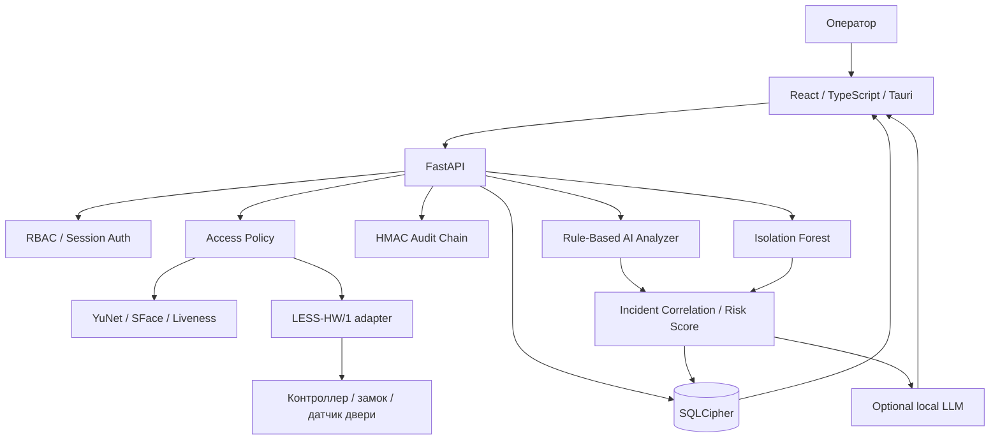

# LESS — Архитектура системы

**LESS (Local Entry Security System)** — локальная многофакторная система контроля и управления доступом.

Рабочая ветка развития: `feat/biometric-ai-analytics`. Документ описывает программные компоненты этой ветки; физическая готовность оборудования подтверждается отдельно.

## 1. Архитектурные принципы

- Решение о проходе принимает детерминированная AccessPolicy, а не ML/LLM.
- Физическое открытие подтверждается защищённым ответом контроллера LESS-HW/1.
- Биометрические кадры и шаблоны обрабатываются локально.
- Аналитические выводы объяснимы и сохраняют ссылки на исходные события.
- Недоступность ML/LLM не влияет на обычную проверку доступа.
- Любые тесты биометрии и изменения статусов инцидентов фиксируются в аудите.

## 2. Высокоуровневая схема

## 3. Контур проверки доступа

1. Frontend получает событие от NFC/камеры и отправляет запрос в FastAPI.
2. Backend проверяет сессию оператора, полномочия, активность субъекта и политики доступа.
3. Для face-flow отдельный endpoint выполняет liveness, извлечение SFace embedding и сопоставление лица с владельцем карты.
4. AccessPolicy проверяет расписания, anti-passback, гостевые разрешения и другие ограничения.
5. Backend формирует команду LESS-HW/1. Команда защищается AES-GCM и привязывается к nonce, sequence и controller ID.
6. Доступ считается успешным только после корректного аутентифицированного ACK контроллера.
7. Результат и события безопасности записываются в SQLCipher и HMAC-аудит.

ML/LLM не могут вызывать открытие замка, менять политики, выдавать права или обходить обязательные проверки.

## 4. Биометрический контур

### Face matching
- YuNet — обнаружение лица.
- SFace — embedding и cosine similarity.
- Текущий production threshold остаётся отдельной настройкой и не изменяется evaluator автоматически.
- `backend/scripts/evaluate_face_threshold.py` формирует FAR/FRR/TAR, ROC/AUC, приближённый EER, доверительные интервалы, ROC SVG и subgroup reports по камере/условиям.

### Liveness / PAD
- Challenge-response использует MediaPipe FaceLandmarker и проверяет последовательность действий.
- PAD-лаборатория позволяет оператору вручную провести bona fide или attack испытание через камеру.
- Сохраняются только класс испытания, тип атаки, исход проверки, камера и условия; кадры не сохраняются.
- Отчёт рассчитывает APCER/BPCER/ACER и доверительные интервалы.

Текущая liveness реализация — эвристическая проверка, не сертифицированная PAD и не гарантия защиты от deepfake.

### Fingerprint
Введён vendor-neutral `FingerprintAdapter` contract с fail-closed поведением, закреплением `FINGERPRINT_DEVICE_ID` и привязкой ответа к одноразовому challenge. Конкретный сенсор, SDK и драйвер ещё не подключены; фактор не участвует в решении о проходе.

## 5. Интеллектуальная аналитика

### Rule-Based Analyzer
Сохраняет прозрачные правила обнаружения известных подозрительных сценариев.

### ML Anomaly Detector
- Isolation Forest на агрегированных профилях субъекта.
- 30-дневное окно по умолчанию.
- Минимум 12 субъектов и 3 события на субъект; настройки конфигурируются.
- Модель обучается в памяти на текущей когорте, не сохраняет pickle и не выдаёт оценку при недостатке данных.
- Relative anomaly score — сравнительный индикатор внутри выборки, не вероятность нарушения.

### Incident Correlation / Risk Engine
Объединяет повторные отказы, ночные проходы, liveness-сбои, события контроллера, быстрые перемещения между дверями и ML-сигналы. Формирует инцидент с факторами, event IDs, временем, уровнем серьёзности и эвристическим risk score 0–100. Оператор может обработать или отклонить инцидент.

Веса risk score требуют дальнейшей калибровки и не являются статистически подтверждённой вероятностью.

### Local AI Assistant
Опциональный read-only помощник через Ollama-compatible runtime на loopback. По умолчанию отключён. Получает ограниченную карточку инцидента, не получает биометрические кадры, шаблоны, raw NFC UID, ключи или инструменты управления.

## 6. Анализ уязвимостей и CI

GitHub Actions запускает:
- Bandit для Python; блокирующий gate — high severity + high confidence;
- Semgrep security rules с сохранением отчёта;
- Gitleaks для поиска секретов;
- pip-audit и npm audit;
- TypeScript/Vite build и backend tests/syntax checks.

Сканеры находят потенциальные проблемы; результаты требуют triage и воспроизводимой проверки. LLM не должна объявлять finding доказанной уязвимостью без подтверждения.

## 7. Хранение и аудит

- SQLCipher — шифрование SQLite.
- Argon2id — хеширование паролей.
- AES-GCM — защита биометрических материалов и сообщений контроллера.
- HMAC-SHA256 — контроль целостности audit chain.
- Отчёты PAD не содержат кадров или биометрических шаблонов.
- Локальный LLM runtime не получает секреты и необработанные персональные идентификаторы.

HMAC-цепочка не является WORM-хранилищем; ключ аудита должен храниться отдельно.

## 8. Текущие границы реализации

- Прошивка физического контроллера, реле и датчик двери требуют отдельной реализации и испытаний.
- NFC UID от обычного считывателя пока не проходит через защищённый контроллерный канал.
- PIN не считать завершённым end-to-end фактором до реализации и тестирования.
- Fingerprint adapter contract не заменяет реальный сенсор и SDK.
- SFace и PAD evaluators готовы, но репрезентативные испытательные выборки ещё должны быть собраны.
- Isolation Forest — экспериментальный baseline, качество на реальных данных не подтверждено.
- Local LLM выключен по умолчанию и требует локальной установки модели.

## 9. Связанные документы

- [README](../README.md)
- [План Biometric AI & Analytics](BIOMETRIC_AI_ANALYTICS_PLAN.md)
- [Политики доступа](ACCESS_POLICIES.md)
- [Протокол контроллера](../backend/CONTROLLER_PROTOCOL.md)
